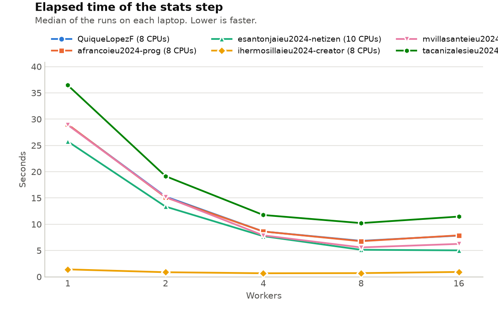

# Lab 1: The Nightly Report

Write your answers in this file. Keep them short: a few sentences, the commands
you used, and the numbers you measured. Copy the lines of output that matter,
not whole screens.

## Warm-up: Generating the report

- What happened, and why: `./run_report.sh` failed with "bad interpreter: Permission denied" (under /usr/bin/time: "cannot run ./run_report.sh: Permission denied", exit status 126). `ls -l run_report.sh` showed `-rw-r--r--`: read and write for the owner, read for group and others, and no execute (x) permission for anyone. Running a file as `./run_report.sh` asks the kernel to execute it, and the kernel checks the x bit. `bash run_report.sh` works anyway because then bash is the program executed, and it only needs to read the script, for which r is enough.
- Your fix, and how it reached your teammates: `chmod +x run_report.sh` in the container, after which `ls -l` showed `-rwxr-xr-x`. On macOS, git saw the change as a mode change (100644 => 100755); it was committed and pushed, and teammates received it with `git pull`. On Windows, git does not see file modes, so the change has to be recorded with `git update-index --chmod=+x run_report.sh` before committing.

## Task 1: Generating the report… again

- Symptom: After making run_report.sh executable, the pipeline ran to the end and printed "Nightly report finished", but revenue_by_region_month.csv was missing from ~/data/out. During the report step the shell printed "Killed", and run_report.sh continued with the next steps as if nothing had happened.
- Commands and recordings you used, why you chose them, and what they showed:
  - `python3 steps/report.py` then `echo $?`: to see how the step ended. It printed "report: loaded 8,400,000 orders (887 MiB)", then "Killed", and the exit status was 137. 137 = 128 + 9, so the process was ended by signal 9 (SIGKILL) and did not stop on its own.
  - `cat /sys/fs/cgroup/memory.events`: to find who sent the signal. `oom_kill 2` (one kill in the full pipeline run, one in the standalone run) shows the kernel's out-of-memory killer ended the process because the container reached its memory limit; `max 3938` shows how often the group hit that limit.
  - `/usr/bin/time` on the first 1M, 2M and 4M orders: to see how peak memory grows with the input. Peak memory was 504,880 KB, 856,796 KB and 1,565,004 KB: linear growth of about 352,000 KB per million orders on top of a ~153,000 KB baseline. Extrapolated to 8.4M orders, the step needs about 3,118,000 KB (~3.0 GiB).
  - `python3 steps/report.py | tee /tmp/report.log`: the log file was empty; even the "loaded" line was missing.
- Cause: report.py loads all 8.4 million orders into memory at once. It then builds two more full copies: a list of 12 monthly subsets (months) and their concatenation (year), so three copies of the 887 MiB table are in memory at once and the step needs ~3 GiB while the container's limit (memory.max) is 2 GiB. When the limit is reached, the kernel's OOM killer sends SIGKILL, which cannot be caught, so the program cannot print an error or finish. The log line was lost because, when stdout is a pipe, Python buffers its output in blocks instead of lines; SIGKILL ended the process before the buffer was flushed. run_report.sh did not check exit statuses, so it kept running.
- Fix: report.py now reads the file in chunks of 1,000,000 rows (pd.read_csv with chunksize), keeps only the four columns it needs, computes the revenue per region and month for each chunk, and adds up these small partial tables at the end. It never holds all orders in memory, and it prints with flush=True so the messages also reach a log through a pipe.
- Before and after (your measurements): Before: full pipeline 160.05 s elapsed, 203.38 s user, 27.83 s system, 2,087,564 KB peak memory; report.py killed, exit status 137, no output file. After: report.py finished in 5.69 s elapsed (5.76 s user, 0.53 s system) with 390,308 KB peak memory, exit status 0, and tools/check.py reports PASS for revenue_by_region_month.csv.

## Task 2: Extracting data

- Symptom: `bash steps/extracts.sh` printed "extracts: done" and exited with status 0, but all six files in ~/data/out/extracts (Benelux, DACH, France, Iberia, Italy, Nordics) were 0 bytes.
- Commands and recordings you used, why you chose them, and what they showed:
  - `cat steps/extracts.sh`: to read what the script does. It changes directory to $OUT/extracts and then reads `../data/sales_2025.csv` with grep, sending grep's errors to /dev/null.
  - The same pipeline run by hand from ~/data/out/extracts, without `2>/dev/null`: grep printed "../data/sales_2025.csv: No such file or directory" and `wc -l` counted 0 lines.
  - `echo ${PIPESTATUS[@]}`: printed `2 0 0`: grep failed with status 2 (error), while cut and wc succeeded with 0.
  - `pwd`: confirmed the working folder was /home/analyst/data/out/extracts.
- Cause: The input path is relative, and it is resolved from the folder the script moved into. From /home/analyst/data/out/extracts, `../data/sales_2025.csv` means /home/analyst/data/out/data/sales_2025.csv, which does not exist; the real file is /home/analyst/data/sales_2025.csv. grep could not open it, so cut received no input and each region file was created empty by the redirection. `2>/dev/null` hid grep's error message. The status of a pipeline is the status of its last command (cut, 0), and the status of the script is that of its last command (`echo "extracts: done"`, 0), so the failure was never reported. The script also ignores the DATA variable that the other steps use.
- Fix: extracts.sh no longer changes directory; it reads the input from DATA (default $HOME/data/sales_2025.csv, an absolute path) like the other steps, and writes to $OUT/extracts. It starts with set -euo pipefail, so a failing command or pipeline stops the script with a non-zero status, and 2>/dev/null was removed so grep's errors are visible. grep's status 1 (no matching orders) is accepted, because a region without orders is not an error.
- Before and after (your measurements): Before: exit status 0, six files of 0 bytes. After: the six files have 1,006,912 (Benelux), 1,846,894 (DACH), 1,345,118 (France), 2,183,057 (Iberia), 1,178,032 (Italy) and 839,987 (Nordics) rows, and tools/check.py reports PASS for all of them; the step took 4.06 s elapsed (5.02 s user, 1.06 s system, 6,564 KB peak memory). It also works when started from another folder (cd ~ && bash work/ospc-lab1-g7/steps/extracts.sh). With a wrong path (DATA=/no/such/file.csv) it now prints grep's error and exits with status 1 instead of printing done.

## Task 3: Auditing

- Symptom: audit.py is slow: 82.21 s for 8.4 million orders, and about a quarter of its CPU time is spent in the kernel.
- Commands and recordings you used, why you chose them, and what they showed:
  - `/usr/bin/time` on the sample (100,000 orders) and on the full file, to separate the program's own work (user) from the kernel's (system). Sample: 1.57 s elapsed, 1.61 s user, 0.39 s system. Full: 82.21 s elapsed, 62.78 s user, 20.04 s system, 634,632 KB peak. Kernel share = 20.04 / (62.78 + 20.04) ≈ 24%, about twice that of report.py (≈ 12%).
  - `strace -c -e trace=openat,write,close` on the sample, to count the system calls that write the file: 100,686 openat, 100,001 write and 100,673 close for 100,000 orders, which is about one of each per order. The output file was 1,952,269 bytes.
- Cause: audit.py opens the output file, writes one line and closes it again for every order. Each of these is a system call, a switch into the kernel, so the program makes about 300,000 system calls for 100,000 orders, and about 25 million for the full file. The comment in the code says this ensures "each line is saved on disk", but that is false: close() only hands the data to the kernel's page cache in memory, and the kernel writes it to disk later. Only fsync() forces data to disk. The script pays the cost without gaining the safety it claims.
- Fix: audit.py now opens the output file once, before the loop, and writes every line through it. Python collects the lines in its buffer and passes them to the kernel in large writes, so the number of openat, write and close calls no longer grows with the number of orders. The misleading comment was replaced: closing a file does not put data on disk; only fsync() does.
- Before and after (your measurements): Before: 82.21 s elapsed, 62.78 s user, 20.04 s system; 100,686 / 100,001 / 100,673 openat / write / close calls on the sample. Expected after: one open and one close of the output file, and about 1,952,269 / 131,072 ≈ 15 write calls with Python's 128 KiB buffer. After: on the sample, strace -c counted 686 openat, 17 write and 673 close calls (the openat and close calls are now almost all Python starting up). On the full file, 16.95 s elapsed (17.05 s user, 0.51 s system, 634,692 KB peak memory): about 4.9 times faster, with 40 times less system time; the kernel share fell from about 24% to about 3%. tools/check.py reports PASS for audit_2025.csv (8,400,000 lines).

## Task 4: Segmenting the orders

- Symptom: segments.py produced a correct segments.csv but took 46.07 s on the 8.4 million orders, with user time (45.19 s) almost equal to elapsed time and little system time (1.53 s): the step was CPU-bound in Python's own code, not waiting for the kernel or the disk.
- Commands and recordings you used, why you chose them, and what they showed: `/usr/bin/time` on the sample (1.04 s) and on the full file (46.07 s) to measure the step and split user from system time. `python3 -m cProfile -s tottime steps/segments.py` on the sample, to see which functions use the time: 3,646,598 function calls in 1.917 s; `segment()` was called 100,000 times (once per order) with a cumulative time of 1.048 s, about 55% of the run, and inside it `datetime.strptime` was also called 100,000 times (0.995 s cumulative), each call also checking the locale (`locale.getlocale`, 100,004 calls).
- Cause: the script loops over the orders with `itertuples()` and calls the Python function `segment()` for every order. For each one it parses the date text with `strptime`, computes the value, chooses the size with if/elif, builds a string such as "Q2 medium" and updates a dictionary. That is 8.4 million interpreted function calls and date parses; the work is the same for every row and could be done on whole columns at once.
- Fix: segments.py now reads the file in chunks of 1,000,000 orders and works on whole columns: `pd.to_datetime(...).dt.quarter` for the quarter, `np.select` with the same thresholds (500 and 100) for the size, stored as a 1-byte code instead of a string per order, and `groupby(...).size()` for the counts. The partial counts of the chunks are added together at the end, and the labels such as "Q1 large" are built only once per group. A first version without chunks and with the size as text was fast but peaked at 1,650,792 KB, more than twice the original, which is why the final version stores codes and reads in chunks.
- Before and after (your measurements): Before: 46.07 s elapsed, 45.19 s user, 1.53 s system, 744,464 KB peak memory; cProfile on the sample: 3,646,598 calls in 1.917 s. After: 6.03 s elapsed, 6.02 s user, 0.61 s system, 374,368 KB peak memory (about 7.6 times faster and half the memory); cProfile on the sample: 454,991 calls in 0.432 s, with no `segment` or `strptime` per order. tools/check.py reports PASS for segments.csv.

## Task 5: Computing the statistics

- Symptom: stats.sh starts 16 workers by default, but it was not faster than with fewer workers (11.18 s with 16 against 10.52 s with 8). When the step was stopped with Ctrl-C, the script ended but its workers kept running in the background.
- Commands and recordings you used, why you chose them, and what they showed: `bash tools/sweep.sh` to time the step with 1, 2, 4, 8 and 16 workers (3 runs each). Average elapsed: 36.6 s (1), 19.4 s (2), 12.0 s (4), 10.6 s (8), 11.5 s (16); `nproc` in the container is 8. To reproduce Ctrl-C reliably, the script was started in the background and, once the workers were running (`pgrep -f stats_worker`), sent SIGINT to its whole process group with `kill -INT -- -PID`, which is what Ctrl-C does. Then `ps -ef | grep "[s]tats_worker"` listed 16 workers still running, each with parent PID 1: the script was gone and the workers had been adopted by PID 1.
- Cause: (1) The default of 16 workers is twice the 8 CPUs of the container. Beyond 8, workers only take turns on the same CPUs, which adds scheduling and start-up overhead (user time rose from 74.01 s to 78.79 s and system time from 3.82 s to 4.43 s) without adding computing power. (2) The workers are started with `&` in a non-interactive script, so bash makes them ignore SIGINT. Ctrl-C ended the script, but nothing told the workers to stop, so they became orphans and kept using CPU.
- Fix: the default is now `WORKERS=${WORKERS:-$(nproc)}` (it can still be overridden). The script saves each worker's PID and sets `trap cleanup INT TERM`: on Ctrl-C or SIGTERM it sends SIGTERM to every worker, waits for them and exits with status 130. It also waits for each worker separately and fails if any worker fails (a plain `wait` always returned 0), and uses `set -euo pipefail`. The comment claiming "more workers, faster results" was corrected.
- Before and after (your measurements): Before: 16 workers, 11.18 s elapsed, 78.79 s user, 4.43 s system; after the simulated Ctrl-C, 16 workers still running. After: 8 workers, 10.52 s elapsed, 74.01 s user, 3.82 s system; after the simulated Ctrl-C the script printed "stats: stopping 8 workers", exited with 130, and 0 workers were left. tools/check.py reports PASS for stats.csv (72 region-months).

## The worker experiment

Every member runs `tools/sweep.sh` on their own laptop. Then run
`python3 tools/plot_sweep.py` and commit `results/sweep.png`.

- How does the elapsed time change with the number of workers on each laptop?
  - On every laptop the time first falls fast and then flattens: on Tomás's laptop 36.6 s with 1 worker, 19.4 s with 2, 12.0 s with 4 and 10.6 s with 8; on Quique's 28.5, 15.3, 8.5 and 6.8 s. Up to 4 workers each doubling almost halves the time; from 4 to 8 the gain is small (12.0 to 10.6 s, 8.5 to 6.8 s); with 16 workers the time gets worse again (11.5 s and 7.9 s). The best speed-up is about 3.5 times (Tomás) and 4.2 times (Quique) with 8 workers, well below 8.
- Why do the curves of your laptops differ? Use the cores and threads of each
  laptop, listed in `TEAM.md`.
  - Both laptops have 8 cores and 8 threads (Apple chips run one thread per core) and the container sees 8 CPUs (`nproc`), so both curves stop improving at 8 workers: more workers than CPUs only take turns on the same CPUs and add overhead (with 16 workers user time rose from 74.01 s to 78.79 s and system time from 3.82 s to 4.43 s on Tomás's laptop). The curves differ in height because the cores are not equally fast: the same work takes 28.5 s on one core of Quique's laptop and 36.6 s on Tomás's. The speed-up is less than 8 because part of the step does not run in parallel (preparing the input and merging the results), because Apple chips mix fast performance cores with slower efficiency cores, so workers 5 to 8 run on slower cores, and because the Docker virtual machine and other programs also use the CPUs. Ivan's sweep is being rerun on the full dataset, and Marina's (10 cores, 10 threads) is still missing.
- Which default number of workers did you choose for `stats.sh`, and why?
  - `WORKERS=${WORKERS:-$(nproc)}`: one worker per CPU that the container can use. On every measured laptop that was the fastest or close to it, and more workers made the step slower. Using `nproc` instead of a fixed number adapts to each machine (8 on our 8-core laptops, 10 on Marina's), and the value can still be overridden with the WORKERS variable.

## Use of generative AI

This report and the fixes were made with the help of Claude (Anthropic).
